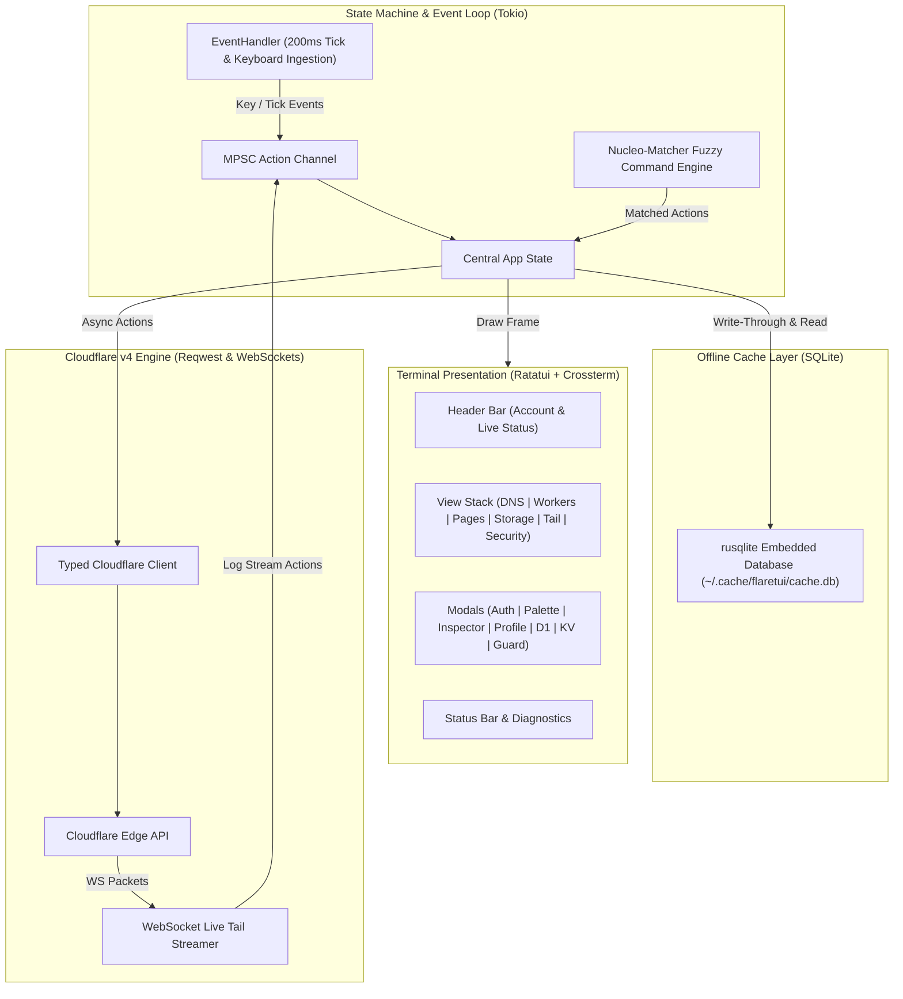

<div align="center">

```text
   __ _               _____ _   _ ___ 
  / _| | __ _ _ __ __|_   _| | | |_ _|
 | |_| |/ _` | '__/ _ \| | | | | || | 
 |  _| | (_| | | |  __/| | | |_| || | 
 |_| |_|\__,_|_|  \___||_|  \___/|___|
```

> **A fast, keyboard-centric, production-grade Terminal User Interface for managing Cloudflare assets.**

[](https://www.rust-lang.org)
[](https://github.com/ratatui/ratatui)
[](https://tokio.rs)
[](https://sqlite.org)
[](https://developers.cloudflare.com/api/)
[](LICENSE-MIT)

<br />

[Features](#features) • [Installation](#installation) • [Authentication](#authentication--token-permissions) • [Keybindings](#keyboard-navigation) • [Architecture](#architecture) • [Roadmap](#roadmap)

</div>

---

## Features

- **Cloudflare Registrar & Domain Portfolio**: Inspect registered domain portfolios, WHOIS contact records, real-time DNSSEC validation status, single-stroke registrar transfer lock toggling (`t`), auto-renewal switches (`a`), and interactive domain registration modal (`n`).
- **Offline-First & Instant Startup**: Boots in milliseconds using an embedded SQLite cache (`~/.cache/flaretui/cache.db`). Browse zones, DNS records, scripts, and bindings even when offline.
- **Interactive DNS & Zone Management**: Instant orange/grey cloud proxy toggling (`p`), inline record creation/editing with safety checks, and single-click BIND zone export (`x`).
- **Workers Inspector & Realtime Live Tail**: Inspect script metadata, route patterns, and active bindings (D1, KV, R2, Queues). Stream live Worker execution logs over WebSockets with exception decoding, regex filtering (`/`), and auto-follow mode (`f`).
- **Cloudflare Pages & Instant Rollback**: Track deployment statuses across preview and production environments, inspect build stages and logs, and execute rollbacks directly from your terminal.
- **Storage & Edge Databases (D1, KV, and R2)**: Interactive D1 SQL Console with table schema explorer, quick query presets, tabular result grid, query history buffer (`↑`/`↓`), and live execution duration metrics. Workers KV key browser with real-time prefix filtering (`/`) and formatted JSON syntax viewer. 3-pane R2 object storage explorer with bucket overview and virtual directory traversal.
- **Interactive WAF Rule Control Engine**: Live rule management in Security View (`Space`/`t` to toggle active/pause, `+`/`-` to reorder priority) with direct Cloudflare Rulesets API persistence.
- **Universal Theme Engine**: Hot-swappable color themes via Command Palette (`Ctrl+P` -> `Theme: ...`) supporting Cloudflare Dark, Catppuccin Mocha, Tokyo Night, and Nord palettes.
- **Browser-Based OAuth Login & Session Logout**: Seamless browser redirection authentication flow using a local loopback callback server on `127.0.0.1`, automatic browser launching (`xdg-open`/`open`/`start`), authorization state validation, manual fallback token input, and one-keystroke session logout (`Ctrl+L`).
- **WAF & Security Analytics Dashboard**: Zone-wide threat score gauge (0-100), interactive security event log explorer with action filter cycling (`f`: Block, Managed Challenge, JS Challenge, Log), and threat timeline distribution.
- **Security & Threat Analytics Dashboard**: Clean 3-column multi-table intelligence grid displaying action breakdown, threat activity timeline, top origin countries, ASNs, targeted endpoints, and WAF rule hit leaderboards.
- **Security Event Inspector**: Deep-dive inspector modal (`Enter`/`i`) displaying request details (client IP, ASN, Ray ID, HTTP method, path, user agent), WAF rule expression, and raw JSON payload with quick clipboard buffer copying (`c` for IP, `r` for Ray ID).
- **Universal Command Palette (`Ctrl+P`)**: Blazing-fast fuzzy search powered by `nucleo-matcher` with real-time character highlighting, category filters (`Tab`/`Shift+Tab`), and single-keystroke action dispatch across views, API sync, cache purges, and tool modals.
- **Multi-Account Profile Switcher (`Ctrl+U`)**: Seamless hot-swapping between multiple Cloudflare accounts and API profiles at runtime without restarting flareTUI.
- **Defensive Safety Safeguards**: Irreversible modifications (deleting records, purging edge cache, rolling back builds) are guarded by interactive confirmation dialogs.
- **Ergonomic Vim Keybindings**: Single-stroke navigation (`j`/`k`, numeric view switching `1`-`7`, `Tab`/`s` pane toggle, and `/` search).

---

## Terminal Interface Preview

```text
  flareTUI    Account: dev@example.com           Cloudflare Live                    Cache: SQLite Local
 1: Zones & DNS │ 2: Workers │ 3: Pages │ 4: D1 & KV │ 5: Live Tail │ 6: Security & WAF │ 7: Domains & Registrar
┌ Zones (Press 's' to switch) ─┐┌ DNS Records: example.com (Total: 6) ──────────────────────────────────────────┐
│▶ example.com     Enterprise   ││ Type    Name               Content / Target            Proxy Status    TTL    │
│  staging-edge.io Pro          ││▶ A       api.example.com    192.0.2.42                  [o] Proxied     Auto   │
│  demo-service.dev Free        ││  CNAME   example.com        my-worker.workers.dev       [o] Proxied     Auto   │
│  internal-vpn.net Business    ││  AAAA    ipv6.example.com   2606:4700:4700::1111        [o] Proxied     Auto   │
│                               ││  MX      example.com        mail.example.com            [ ] DNS Only    Auto   │
│                               ││  TXT     _dmarc.example.com "v=DMARC1; p=reject;..."    [ ] DNS Only    Auto   │
│                               ││  TXT     example.com        "v=spf1 include:_spf...~all"[ ] DNS Only    3600s  │
└───────────────────────────────┘└──────────────────────────────────────────────────────────────────────────────┘
 [Ctrl+P] Palette  [Ctrl+U] Profiles  [1-7] Tabs  [s/Tab] Switch  [p] Proxy  [?] Help  [q] Quit
```

---

## Installation

### Prerequisites
- **Rust Toolchain**: `1.80+` (pinned to `1.89.0` via `rust-toolchain.toml`)
- **Terminal Emulator**: Any terminal with TrueColor and Unicode support (Alacritty, Kitty, WezTerm, Ghostty, Zellij, Tmux).

### Build from Source

```bash
# 1. Clone the repository
git clone https://github.com/KidusAlemayehu/flareTUI.git
cd flareTUI

# 2. Build the optimized release binary
cargo build --release

# 3. Launch flareTUI
./target/release/flareTUI
```

### Quick Install with Cargo

```bash
# Install directly from Git repository
cargo install --git https://github.com/KidusAlemayehu/flareTUI

# Or install from local clone
cargo install --path .

# Launch flareTUI from anywhere
flareTUI
```

---

## Authentication & Token Permissions

When launching `flareTUI` for the first time, an authentication modal appears automatically. Alternatively, press **`Ctrl+A`** at any point to configure or update your credentials.

`flareTUI` supports two authentication flows:
1. **Browser Login (OAuth)**: Automatically redirects to your default web browser, spawns a local loopback callback server on `127.0.0.1`, and securely captures your credentials upon approval.
2. **API Token (Manual)**: Direct input and validation of a Cloudflare User API Token.

To log out of the active profile and return to offline cached mode, press **`Ctrl+L`** or select **`Log Out Active Session`** in the Command Palette (**`Ctrl+P`**).

### Recommended Token Permissions
Create a Cloudflare **User API Token** at [dash.cloudflare.com/profile/api-tokens](https://dash.cloudflare.com/profile/api-tokens) using the **Edit zone DNS** template or with the following permissions:

| Permission Group | Scope | Access Level | Purpose |
| :--- | :--- | :--- | :--- |
| **Zone ➔ DNS** | All Zones (or Specific Zone) | **Edit** (or Read) | View, create, update, and toggle proxy status |
| **Zone ➔ Zone Settings** | All Zones (or Specific Zone) | **Read / Edit** | Inspect SSL mode, Security level, Dev mode, Purge cache |
| **Account ➔ Worker Scripts**| All Accounts | **Read** | List scripts, inspect routes and bindings |
| **Account ➔ Worker Tail** | All Accounts | **Read** | Stream real-time WebSocket live tail logs |
| **Account ➔ Cloudflare Pages** | All Accounts | **Read / Edit** | View deployments, build logs, and trigger rollbacks |
| **Account ➔ D1** | All Accounts | **Read / Edit** | Query and browse D1 databases |
| **Account ➔ Workers KV Storage** | All Accounts | **Read** | List namespaces, browse keys, inspect values |
| **Zone ➔ Security Events** | All Zones (or Specific Zone) | **Read** | Inspect WAF firewall events, threat scores, and blocked IPs |
| **Zone ➔ WAF Rulesets** | All Zones (or Specific Zone) | **Read** | View firewall rules and rule expression triggers |

> [!TIP]
> Always generate a **User API Token** under **User Profile (top-right avatar) ➔ My Profile ➔ API Tokens** rather than an Account API Token to ensure zone-level DNS listing and modifications succeed.

### Configuration File
Credentials and account profiles are stored locally in `~/.config/flaretui/config.toml`:

```toml
# Currently active profile
current_profile = "production"

# Multi-account profile configurations
[[profiles]]
name = "production"
api_token = "cfut_prod_token_abcdef1234567890"
account_id = "0123456789abcdef0123456789abcdef"
account_name = "Production Team"

[[profiles]]
name = "staging"
api_token = "cfut_staging_token_1234567890abcdef"
account_id = "fedcba9876543210fedcba9876543210"
account_name = "Staging Environment"
```

---

## Keyboard Navigation

flareTUI is designed for efficient, mouse-free terminal workflows. Press **`?`** at any time to open the context-aware shortcuts modal for your active view.

| Shortcut | Action |
| :--- | :--- |
| `Ctrl+P` | Open **Universal Command Palette** (fuzzy search all actions & tools) |
| `Ctrl+U` | Open **Multi-Account Profile Switcher** |
| `Ctrl+L` | Log out active profile session |
| `Ctrl+A` | Open **Authentication Modal** |
| `1` .. `7` | Direct tab navigation (`Zones`, `Workers`, `Pages`, `Storage`, `Tail`, `Security`, `Domains`) |
| `Tab` / `s` | Cycle focus between panes |
| `j` / `k` or `↓` / `↑` | Navigate table rows and list items |
| `r` | Invalidate cache and fetch live state from Cloudflare edge |
| `?` | Toggle in-app interactive keybinding help modal |
| `Esc` / `q` | Close active modal dialog or exit flareTUI |

> [!TIP]
> For the complete per-view shortcut reference (including D1 SQL presets, WAF rule reordering, and WebSocket log filters), consult the comprehensive [Keybindings Reference Guide](docs/keybindings.md).

---

## Architecture

`flareTUI` follows an asynchronous, action-driven architecture separating terminal drawing from non-blocking Cloudflare network operations:



---

## Roadmap

- [x] **Milestone 1**: Core TUI scaffolding, Crossterm/Ratatui event loop, async Tokio architecture.
- [x] **Milestone 2**: Cloudflare v4 typed HTTP client, token authentication, and profile persistence.
- [x] **Milestone 3**: Offline SQLite caching layer, zone browser, and DNS management with proxy toggling.
- [x] **Milestone 4**: Interactive DNS editing, record creation, deletion safety guards, and BIND zone exports.
- [x] **Milestone 5**: Zone Inspector modal (SSL setting toggle, Dev mode, Security level, Edge cache purge).
- [x] **Milestone 6**: Workers script explorer, metadata inspection, and D1/KV/R2/Queue bindings resolution.
- [x] **Milestone 7**: Realtime Worker live tail session dispatcher over WebSockets with in-memory filtering & follow mode.
- [x] **Milestone 8**: Pages projects overview, deployment history, build log viewer, and rollback dispatcher.
- [x] **Milestone 9**: Storage Browser (Interactive D1 SQL query runner and KV namespace key-value explorer).
- [x] **Milestone 10**: WAF & Security analytics dashboard, multi-account fuzzy command palette (`Ctrl+P`), runtime profile switcher.
- [x] **Milestone 11**: Security & Threat Analytics dashboard (3-column multi-table grid, threat scoring, activity timeline, origin country & ASN breakdown).
- [x] **Milestone 12**: R2 Object Storage Explorer (3-pane bucket and object hierarchy navigation, virtual directory traversal, local SQLite schema caching).
- [x] **Milestone 13**: Interactive WAF Control Engine (live rule toggling, priority reordering, safety confirmations, and ruleset mutations).
- [x] **Milestone 14**: Universal Theme Engine (runtime palette switching via Command Palette: Cloudflare Dark, Catppuccin Mocha, Tokyo Night, Nord).
- [x] **Milestone 15**: Release Documentation & Packaging (v0.7.0 crate release, expanded feature documentation, changelog synchronization).

---

## Contributing

Contributions, issues, and feature requests are welcome!
Feel free to open an issue or submit a pull request on [GitHub](https://github.com/KidusAlemayehu/flareTUI).

```bash
# Run test suite
cargo test

# Check formatting and clippy lints
cargo fmt --check
cargo clippy -- -D warnings
```

---

## License

Dual-licensed under either:
- **MIT License** ([LICENSE-MIT](LICENSE-MIT) or [http://opensource.org/licenses/MIT](http://opensource.org/licenses/MIT))
- **Apache License, Version 2.0** ([LICENSE-APACHE](LICENSE-APACHE) or [http://www.apache.org/licenses/LICENSE-2.0](http://www.apache.org/licenses/LICENSE-2.0))

at your option.
